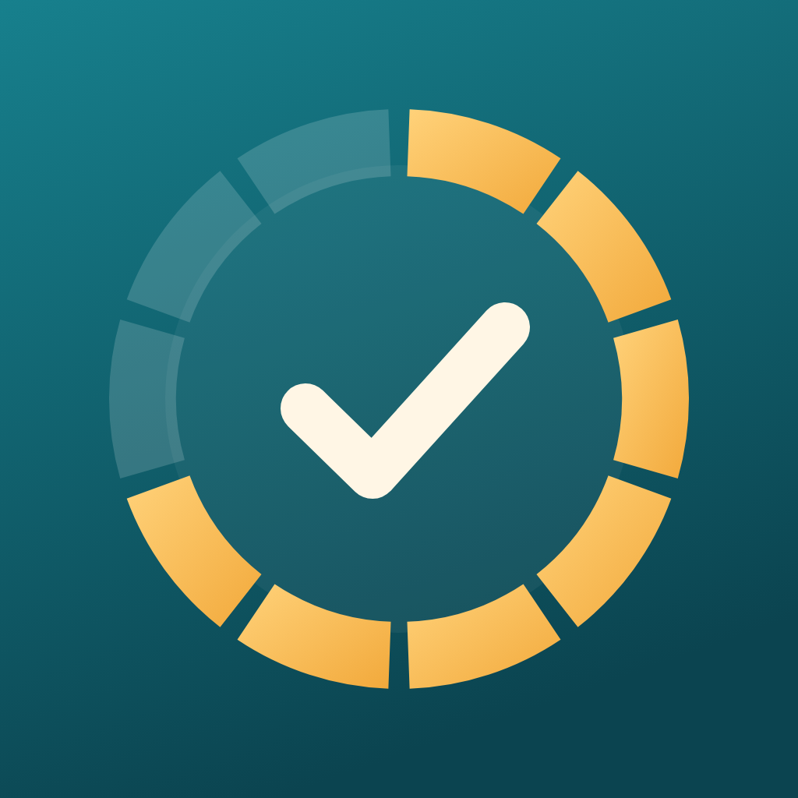
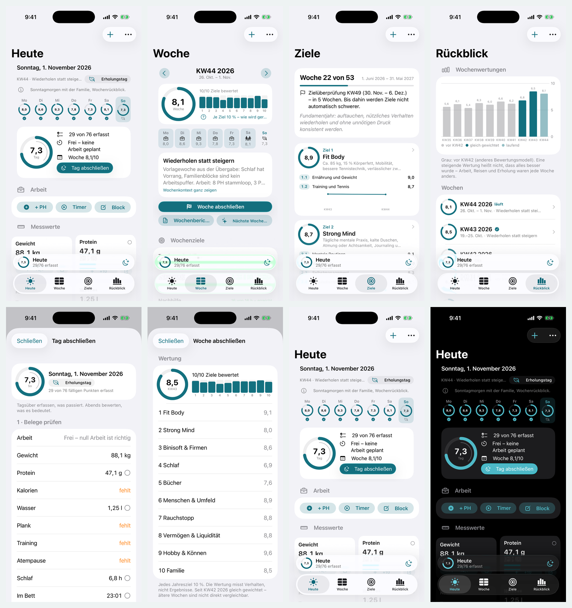
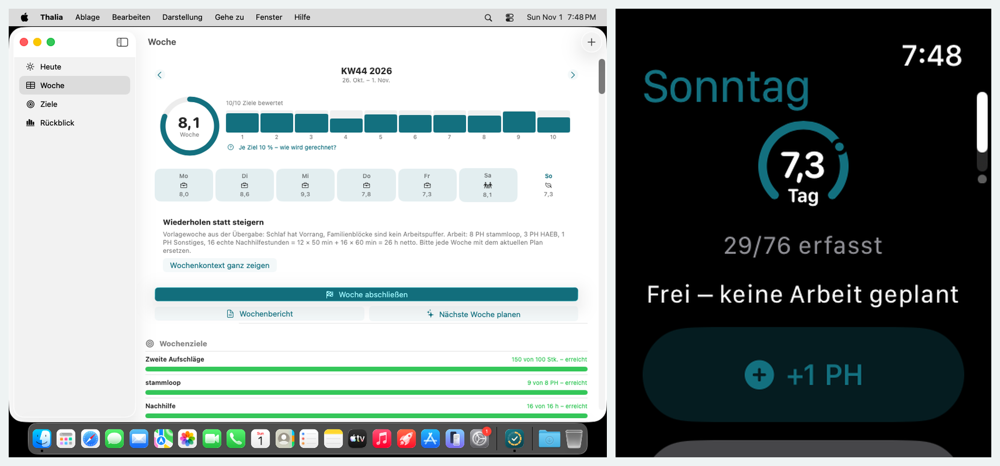

<p align="center"></p>

# Thalia – Your Tracker Buddy

App Store name **Thalia - Your Tracker Buddy** · home-screen name **Thalia** · bundle ID `at.binisoft.thalia`

Thalia replaces the printed weekly goal tracker and the sheet of paper at the desk – not the
ritual. Ten annual goals give continuity, the weekly plan (written with ChatGPT, imported as CSV)
gives context, the daily record gives evidence, and the evening and weekly reflection give meaning.
Built on the [Binisoft handbook](https://github.com/Binisoft-at/binisoft-handbook) v1.

## What's in it

- **Heute** – capture during the day: + Power-Hour (50 min) or a timer with Live Activity, real
  tutoring hours, measurements with +/− and Apple Health suggestions, the items due today with
  ✓ ½ ✗ N/A, notes (trigger, success, contact, parked idea). **Tag abschließen** in the evening:
  check evidence, fill gaps, confirm categories (own score possible), reflect.
- **Woche** – the tracker sheet: ten items per category × Mo–So, week score with the ten goals at
  10 % each, weekly targets with an even-pace marker, day types, **Woche abschließen** with the
  report and the planning prompt for the next Sunday conversation.
- **Ziele** – the ten annual goals, year progress, the KW49 review, trends.
- **Rückblick** – every week's score (paper history before KW42 shown apart) and its report.
- **Import & export** – the planning prompt → ChatGPT → CSV → preview → import; your own CSV; export
  and backup in the same format. Format: [docs/IMPORT.md](docs/IMPORT.md).
- **Everywhere** – iPhone, iPad, Mac (menus, shortcuts), Apple Watch (+1 PH, timer, measurements,
  open items), widgets, Shortcuts, reminders (morning start, evening review, Sunday, 50-minute stop).
- Tour, hints, in-app explainers (scoring, power-hours, marks), Settings with iCloud status,
  "Wo deine Daten liegen", app log. German throughout.

Your workflow mapped to the app, the scoring and the research behind it: [docs/WORKFLOW.md](docs/WORKFLOW.md).




(Demo data from the CI screenshot run – `-Demo` launches, never your data.)

## Repo layout

| Path | What |
|---|---|
| `Packages/ThaliaCore` | All rules: weeks, scoring, CSV contract, reports, template, demo. Swift Testing, runs on Linux |
| `Shared/` | SwiftData models, the store, week context, persistence, widget bridge |
| `App/` | iOS + macOS app |
| `Watch/`, `Widgets/` | Apple Watch app, widgets + Live Activity |
| `Config/` | identifiers (`Base.xcconfig`), `ci.env`, Info.plists, entitlements |
| `cloudkit/schema.ckdb` | CloudKit schema |
| `docs/` | [WORKFLOW](docs/WORKFLOW.md), [IMPORT](docs/IMPORT.md), [TOUR](docs/TOUR.md), [ARCHITECTURE](docs/ARCHITECTURE.md), [SETUP](docs/SETUP.md) |
| `Vendor/BinisoftKit`, `scripts/ci`, `.github/workflows` | synced from the handbook – never edited here |

## Build and check

```bash
make check      # no Mac: Core tests (Docker swift:6.2-noble or a toolchain) + syntax of the app code
make open       # Mac: generate the project and open Xcode
```

CI: every push to `main` (Linux Core tests, then unsigned macOS and iOS builds; `[screenshots]` adds
screenshots). TestFlight: `[testflight]` in the commit message. Results:
`git fetch origin ci-output && git show origin/ci-output:ci/status.txt`. Setup: [docs/SETUP.md](docs/SETUP.md).
